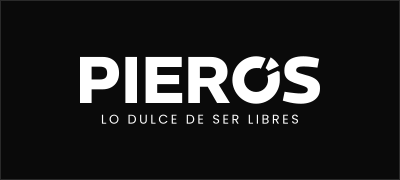
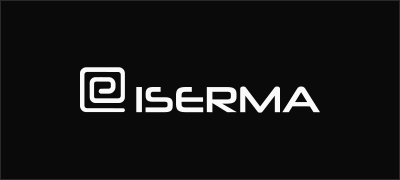
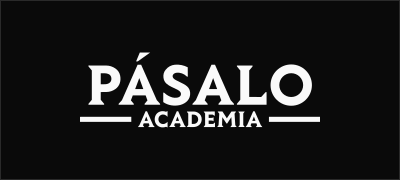
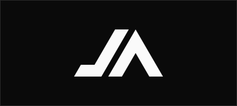

# Johan Amador

Software developer based in Lima, Perú. I build full-stack web applications, business systems and healthcare integrations, from requirements to deployment and maintenance.

[Portfolio](https://johanamador.com/) · [LinkedIn](https://www.linkedin.com/in/johanamadordev/)

  
  
  
  
  
  
  
  
  
  
  
  
  
  
  
  
  
  

